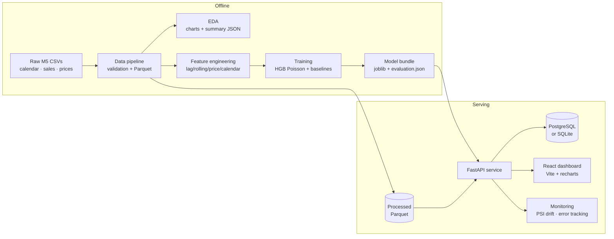
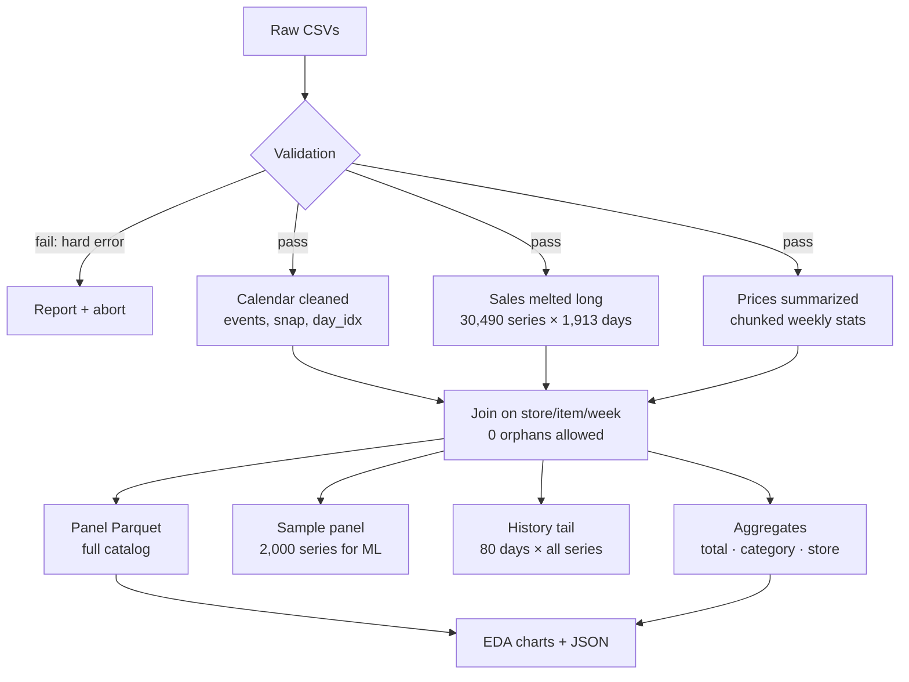

# ElasticIQ

**Demand forecasting, pricing intelligence, and inventory decision support over the
M5 retail dataset.**

A production-style Python/React system: a deterministic data pipeline, leakage-safe
ML forecasting with honest baseline comparisons, pricing engines that refuse to hide
their assumptions, inventory planning under user-supplied parameters, a FastAPI backend
with PostgreSQL/SQLite persistence, PSI drift monitoring, and a React dashboard — all
backed by tests and CI.



## Table of contents

- [Honest headline results](#honest-headline-results)
- [Quickstart](#quickstart)
- [Architecture](#architecture)
- [Data pipeline](#data-pipeline)
- [Forecasting](#forecasting)
- [Pricing intelligence](#pricing-intelligence)
- [Inventory planning](#inventory-planning)
- [API](#api)
- [Monitoring](#monitoring)
- [Testing & CI](#testing--ci)
- [Docker](#docker)
- [Project structure](#project-structure)
- [Limitations & honesty contract](#limitations--honesty-contract)

## Honest headline results

All numbers below are **measured on a chronological holdout** (train `d_1..d_1885`,
validate `d_1886..d_1913`, 2,000 series, recursive 28-day protocol). Baselines are
evaluated on the **identical series and dates**. Nothing is rounded up for presentation.

| Model (h28 WAPE, ↓ better)         | h7      | h14     | h28     |
| ---------------------------------- | ------- | ------- | ------- |
| **HGB Poisson (extended features)** | 83.21 % | 86.12 % | **88.83 %** |
| Mean baseline                      | 82.93 % | 84.17 % | **86.49 %** |
| Last-day naive                     | 97.69 % | 99.78 % | 102.09 % |
| Weekly seasonal naive              | 99.29 % | 101.06 % | 103.89 % |

**The gradient-boosting model beats both naive baselines at every horizon but still
loses to the plain mean baseline (88.83 % vs 86.49 % at h28).** Most M5 series are
intermittent; a constant mean is genuinely hard to beat. We report this as measured
instead of shopping for a flattering metric. By category (model, h28): HOUSEHOLD
82.73 %, FOODS 91.95 %, HOBBIES 97.37 %.

## Quickstart

Prerequisites: Python 3.14 (3.12+ likely works), Node 22+, ~2 GB RAM for the pipeline.

```bash
# 1. Python environment
python -m venv .venv
.venv\Scripts\activate          # Windows
pip install -r requirements.txt

# 2. Place the raw M5 files in data/raw/ (see below) and build everything:
python -m src.data.pipeline      # validates + writes Parquet (~27 s)
python -m src.eda.run            # 10 charts + eda_summary.json
python -m src.forecasting.train  # trains HGB + baselines (~3.5 min)
python -m src.db.seed            # catalog + model version rows in the DB
python -m alembic upgrade head   # canonical schema migration

# 3. Run the API (also serves the built dashboard when frontend/dist exists)
python -m uvicorn src.api.app:app --reload
# -> http://127.0.0.1:8000/docs   (OpenAPI)   ·   http://127.0.0.1:8000/  (dashboard)

# 4. Frontend development (hot reload, proxies to :8000)
cd frontend && npm install && npm run dev   # http://localhost:5173
```

Raw data expected in `data/raw/` (Kaggle M5 Forecasting Accuracy competition):
`calendar.csv`, `sales_train_validation.csv`, `sell_prices.csv`,
`sample_submission.csv`. The pipeline validates ids, maps calendar↔sales day counts,
and price coverage before processing anything.

## Architecture

| Layer           | Technology                                              |
| --------------- | ------------------------------------------------------- |
| API             | FastAPI + Pydantic v2 (typed, versioned `/api/v1`)       |
| Persistence     | SQLAlchemy 2.x + Alembic; PostgreSQL (prod) / SQLite (dev) |
| ML              | scikit-learn `HistGradientBoostingRegressor` (poisson loss) |
| Storage format  | Parquet (gzip-CSV fallback when pyarrow is missing)      |
| Frontend        | React 19 + TypeScript (strict) + Vite 7 + Recharts       |
| Quality         | pytest (137 tests), Ruff, GitHub Actions CI              |

Key design decisions:

- **Load once, serve many** — an `AppState` singleton holds processed frames and the
  joblib bundle; requests never re-read Parquet or re-load models.
- **Parquet for analytics, SQL for state** — millions of sales values stay in Parquet;
  PostgreSQL stores catalog refs, model versions, forecast runs/points, pricing
  scenarios, and inventory recommendations.
- **The API tells the truth** — `/health` reports real readiness (missing data or model
  → `degraded`, never a fake green), and every engine response carries its assumptions.

## Data pipeline



Verified run: **30,490 series · 3,826,000 sample-panel rows · 6,841,121 price rows
matched · 0 orphan prices · ~27 s.** Determinism: fixed sample (series head), fixed
seed, sorted outputs.

## Forecasting

- **Features (leakage-safe):** lags 1/3/7/14/28, rolling mean 7/14/28/56, rolling std
  7/28, price level + relative price, log1p transforms, day trend, calendar
  (weekday/month/events/SNAP — SNAP and events are known in advance).
- **Split:** chronological only. No random splits, no shuffling across time, no future
  information (a leakage bug in the history-tail slicing was caught by a test and fixed).
- **Inference:** recursive — each prediction is fed back into feature history, matching
  deployment reality. Future sell prices default to the last observed price and are
  explicitly listed as an assumption in every API response. Train/serve history windows
  share a single constant (`REQUIRED_HISTORY_DAYS = 60`), so features computed at
  inference match training.
- **Model registry:** each version directory holds `bundle.joblib`, `metadata.json`,
  `evaluation.json`, and `validation_predictions.parquet`; the DB `model_versions` row
  is refreshed by the seed whenever a version is retrained.

## Pricing intelligence

The M5 dataset is **observational**: prices were not randomized, so no causal price
effect can be estimated. Every pricing call must state its demand-response assumption:

| Model          | Meaning                                              |
| -------------- | ---------------------------------------------------- |
| `constant`     | demand does not change with price (pure arithmetic)   |
| `elasticity`   | constant elasticity: units ratio = `(p_new/p_cur)^ε`  |
| `linear_slope` | linear demand: units change by slope per currency unit |

- **Scenario simulation** — revenue/profit deltas with constraint checks (price bounds,
  max change %, min margin, inventory cap) and per-scenario warnings.
- **Constrained optimization** — grid search maximizing `units(p)·(p−cost)` under the
  caller's constraints; the response states "optimal *under stated assumptions*".
- **Sensitivity sweep** — the same price move under ε ∈ {−0.5 … −3.0}, exposing exactly
  how much the conclusion depends on an assumption the data cannot identify.
- **Association analysis** — top co-purchasing item pairs (ASSOCIATION ONLY labels), plus
  a simulated randomized-vs-confounded dataset demonstrating the causal-plumbing
  difference that observational data cannot resolve.

## Inventory planning

M5 contains **no stock positions, open orders, or lead times**. Every inventory
parameter (on-hand, open orders, lead time, review period, service level) is supplied
by the caller; demand statistics come either explicitly or from the trained forecast.
Computed: lead-time demand, safety stock (`z·σ·√lead`, normal approximation), reorder
point, order-up-to level, suggested replenishment, days of cover, and
stockout/overstock indicators — each returned with its assumptions list.

## API

Base: `http://127.0.0.1:8000` · interactive docs at `/docs` · CORS from settings.

| Method | Path                              | Purpose                                        |
| ------ | --------------------------------- | ---------------------------------------------- |
| GET    | `/health`                         | Real readiness: DB, datasets, model bundle      |
| GET    | `/api/v1/overview`                | Coverage, totals, shares, model summary         |
| GET    | `/api/v1/products`                | Catalog, paginated + search/category/store filters |
| GET    | `/api/v1/products/{series_id}`    | Detail: price stats, observed history, intermittency |
| GET    | `/api/v1/stores`                  | Store totals and shares (full catalog)          |
| GET    | `/api/v1/sales/trends`            | Daily units; filter by store **or** category    |
| POST   | `/api/v1/forecasts`               | Run + persist a forecast (horizon 1–56)         |
| GET    | `/api/v1/forecasts` / `/{id}`     | List stored runs / read one back                |
| POST   | `/api/v1/pricing/scenarios`       | What-if under a stated demand model             |
| POST   | `/api/v1/pricing/optimize`        | Constrained profit-maximizing price search      |
| POST   | `/api/v1/pricing/sensitivity`     | Elasticity sweep for one price move             |
| POST   | `/api/v1/inventory/recommendations` | Plan from forecast or explicit demand stats   |
| GET    | `/api/v1/models` / `/{version}`   | Registry: metadata + holdout evaluation         |
| GET    | `/api/v1/monitoring/drift`        | PSI demand/price drift + staleness              |
| GET    | `/api/v1/monitoring/evaluation/{v}` | Offline validation replay                     |
| POST   | `/api/v1/monitoring/score`        | Score actuals vs predictions (live tracking)    |

## Monitoring

- **Drift (PSI)** — decile-binned population stability index of per-series mean daily
  units (last 28 days vs prior 28, from the 80-day tail covering all 30,490 series) and
  of first-vs-last observed prices. Labels (stable < 0.10 < moderate < 0.25 <
  significant) are heuristics, not statistical tests — stated in every response.
- **Error tracking** — `/monitoring/score` computes WAPE/MAE/bias per horizon and
  category whenever actuals arrive; the evaluation endpoint replays the stored offline
  holdout, labeled as a replay rather than live monitoring.
- **Staleness** — artifact age and dataset-vs-wall-clock age, with the caveat that M5
  ends in 2016 by design (large wall-clock age is expected, not an alert).

## Testing & CI

```bash
python -m pytest tests -q      # 137 tests, all fixture-driven (no raw dataset needed)
python -m ruff check src tests
cd frontend && npm run build   # tsc --noEmit (strict) + vite build
```

Coverage spans: pipeline validation and leakage guards, feature windows, training
protocol, inference recursion, pricing engine math and constraint enforcement, inventory
arithmetic, DB models/cascade/seed idempotency, PSI/scoring/staleness math, and
end-to-end API tests (TestClient + tmp Parquet + tmp SQLite).

CI (`.github/workflows/ci.yml`) runs backend lint+tests on Python 3.14 and a frontend
typecheck+build on Node 22 — both data-free by design.

## Docker

`Dockerfile` (multi-stage: node build → python 3.14-slim serving API + dashboard) and
`docker-compose.yml` (PostgreSQL 16 + API) are provided.

> **Not locally verified** — Docker is not installed on the machine where this was
> authored, so `docker build` / `docker compose up` are untested here. Processed data
> is mounted, not baked into images (see comments in the files).

## Project structure

```
ElasticIQ/
├── src/
│   ├── config.py            # env-driven settings (single source of paths/tunables)
│   ├── data/                # pipeline, validation, Parquet storage helpers
│   ├── eda/                 # analysis, charts, report runner
│   ├── features/            # leakage-safe feature engineering
│   ├── forecasting/         # baselines, training orchestrator, recursive inference
│   ├── evaluation/          # WAPE/MAE/RMSE/RMSSE
│   ├── pricing/             # scenario, optimizer, sensitivity, associations
│   ├── inventory/           # ROP / safety stock / order-up-to planning
│   ├── monitoring/          # PSI drift, error tracking, staleness
│   ├── db/                  # SQLAlchemy models, sessions, seed
│   └── api/                 # FastAPI app, schemas, routers, AppState
├── migrations/              # Alembic (initial schema: 7 tables)
├── tests/                   # 137 fixture-driven tests
├── frontend/                # React + TS + Vite dashboard (8 screens)
├── artifacts/               # model bundle, evaluation, EDA charts (committed)
├── data/                    # raw + processed (gitignored) · SQLite (gitignored)
├── Dockerfile · docker-compose.yml · .github/workflows/ci.yml
└── alembic.ini · pyproject.toml · requirements.txt · .env.example
```

## Limitations & honesty contract

1. **Observational data** — no causal claims anywhere. Pricing outcomes are computed
   under *your* stated demand model, echoed back in every response.
2. **High forecast error is real** — h28 WAPE ≈ 89 % on intermittent retail demand;
   the mean baseline still wins. Use forecasts as one input to judgment, not gospel.
3. **Sample vs catalog** — ML trains on a deterministic 2,000-series sample; catalog,
   aggregates, and the history tail cover all 30,490 series.
4. **No warehouse data** — inventory results are recommendations under supplied
   parameters, never a reflection of actual stock.
5. **Frozen dataset** — M5 ends 2016-04-24; staleness vs wall-clock time is expected.
6. **Docker unverified** — files provided but not built locally (no Docker installed).
7. **Windows-first** — commands shown for PowerShell; macOS/Linux use `source`-style
   activation and forward-slash paths.

---

Built with FastAPI, scikit-learn, SQLAlchemy, Alembic, React, and Recharts.
